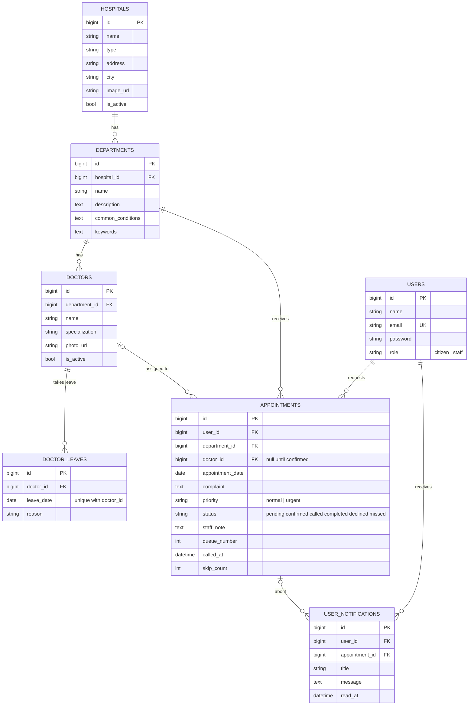

# ERD – QuickCare

Diagram basis data (MySQL). Gambar: [`ERD.png`](ERD.png).

## Catatan

- `users.role` bernilai `citizen` atau `staff`.
- `appointments.doctor_id` kosong sampai staf mengonfirmasi permintaan.
- `appointments.status`: pending → confirmed → called → completed. Cabang lain: declined (ditolak staf) dan missed (telat/skip 2 kali).
- Telat 10 menit setelah dipanggil: status kembali `confirmed`, nomor antrian jadi terakhir, `skip_count` bertambah.
- `doctor_leaves`: satu dokter hanya boleh punya satu baris cuti per tanggal (unique `doctor_id` + `leave_date`). Staf tidak bisa mengonfirmasi dengan dokter yang cuti di tanggal kunjungan.
- Tabel bawaan Laravel (`personal_access_tokens`, `sessions`, `cache`, `jobs`, `migrations`) tidak digambar.
